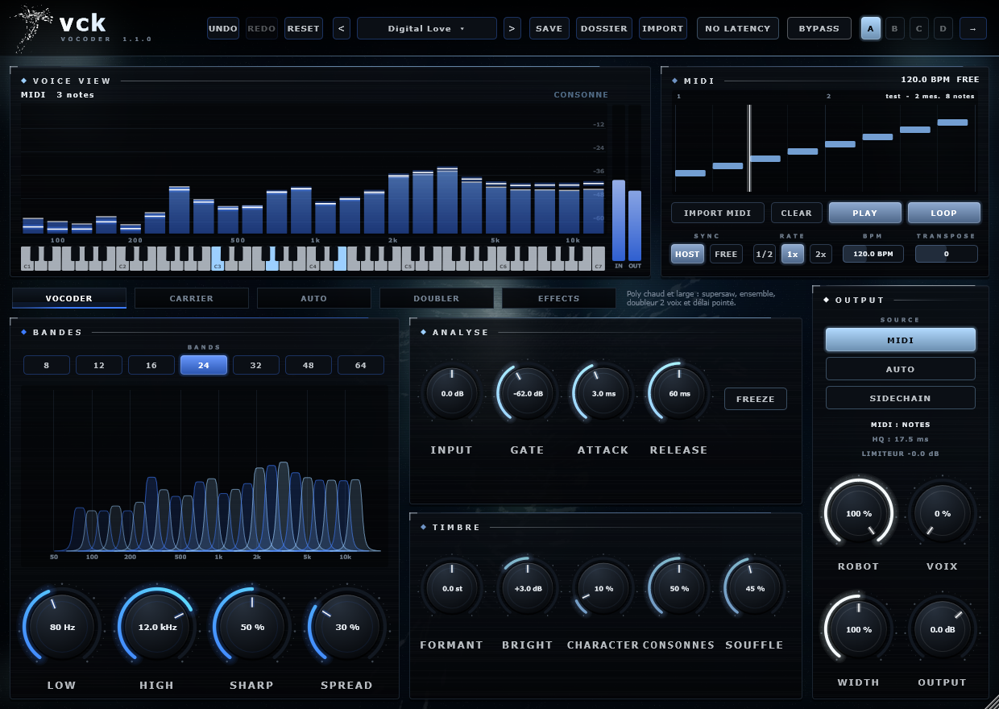
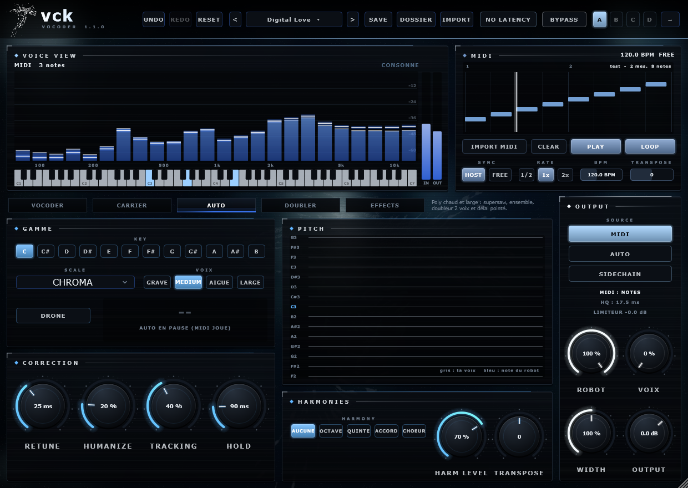
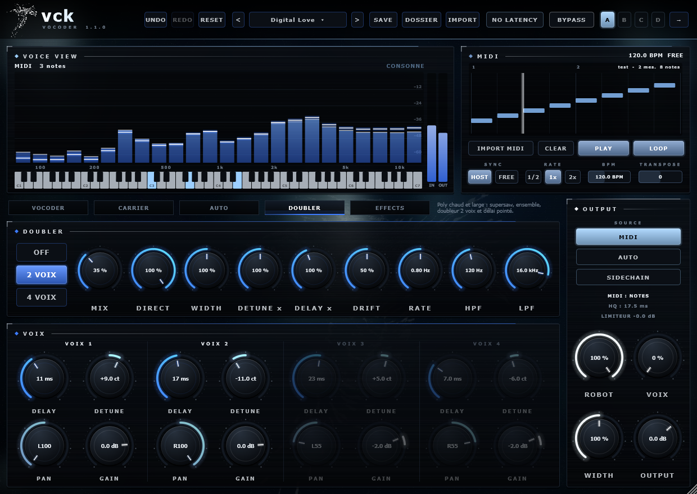
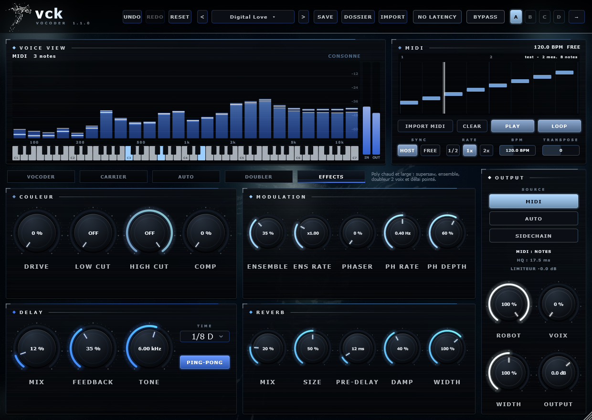
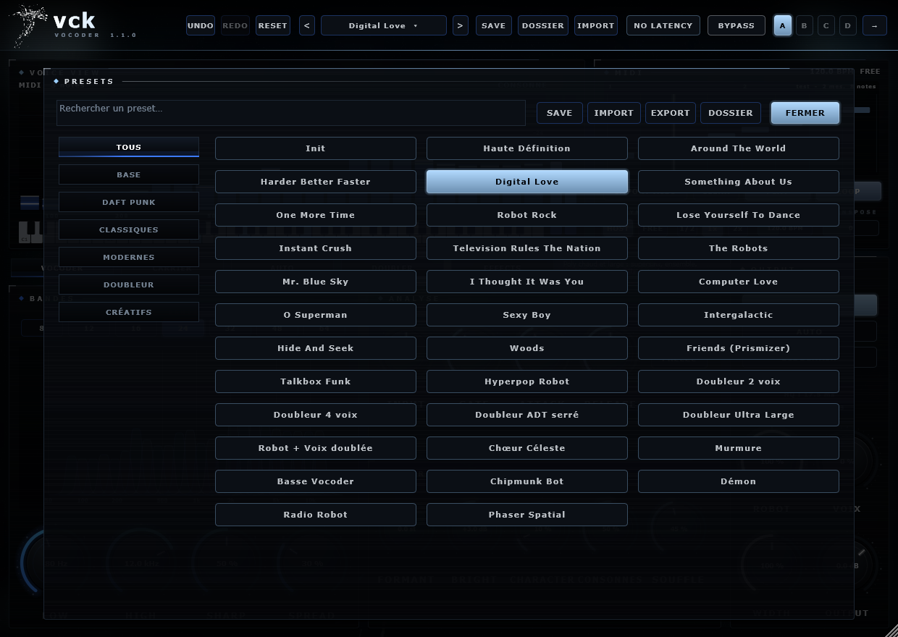

# vck — vocoder

Vocoder VST3 / AU / application autonome, Windows et macOS (Apple Silicon + Intel).
Même univers visuel que **ravenn**.



## Installer

Télécharge l'installeur dans la page **Releases** du dépôt :

- **Windows** : `vck-1.1.0-windows-setup.exe` → installe le VST3 (`C:\Program Files\Common Files\VST3`) et l'application.
- **macOS** : `vck-1.1.0-macos.pkg` → installe VST3, AU et l'application.
  Le plugin n'est pas notarisé : si macOS bloque l'installeur, clic droit → **Ouvrir**.

## En 30 secondes

1. Mets **vck** sur ta piste de voix.
2. Choisis la **SOURCE** (ce qui joue les notes du robot) :
   - **AUTO** : rien à faire, chante — la porteuse suit ta voix, calée dans la gamme (KEY / SCALE), avec harmonies possibles.
   - **MIDI** : joue des notes sur la piste de vck, ou **glisse un fichier `.mid`** dans la fenêtre.
     Le clip se cale tout seul sur le **BPM du DAW** (et suit la lecture), ou tourne en boucle au BPM réglé en mode **FREE**.
   - **SIDECHAIN** : un synthé externe envoyé dans l'entrée sidechain de vck.
3. Choisis un preset.

## Presets

Calés sur des sons célèbres (inspirations, pas des samples) :

| Catégorie | Presets |
|---|---|
| **DAFT PUNK** | Around The World, Harder Better Faster, Digital Love, Something About Us, One More Time, Robot Rock, Lose Yourself To Dance, Instant Crush, Television Rules The Nation |
| **CLASSIQUES** | The Robots (Kraftwerk), Mr. Blue Sky (ELO), I Thought It Was You (Herbie Hancock), Computer Love (Zapp), O Superman (Laurie Anderson), Sexy Boy (Air), Intergalactic (Beastie Boys) |
| **MODERNES** | Hide And Seek (Imogen Heap), Woods (Bon Iver), Friends / Prismizer (Francis and the Lights), Talkbox Funk, Hyperpop Robot |
| **DOUBLEUR** | Doubleur 2 voix, Doubleur 4 voix, Doubleur ADT serré, Doubleur Ultra Large, Robot + Voix doublée |
| **CRÉATIFS** | Chœur Céleste, Murmure, Basse Vocoder, Chipmunk Bot, Démon, Radio Robot, Phaser Spatial |

Tes presets : bouton **SAVE** (dossier `Documents/vck/Presets`).

## Ce qu'il y a dedans

**En-tête comme ravenn** : UNDO / REDO / RESET, page de presets (catégories, recherche, SAVE / IMPORT / EXPORT / DOSSIER), slots A / B / C / D, **NO LATENCY**, BYPASS.
Un preset ne change jamais ta **gamme** (KEY / SCALE), ton clip MIDI, ton niveau d'entrée ni ta sortie.

- **VOCODER** — 8 à 64 bandes, vrais passe-bandes de **Butterworth** (8e ordre en analyse, 6e en synthèse) calculés en tableaux (vectorisés).
  Sortie de chaque bande bornée échantillon par échantillon : aucun pic, aucun clic, même au changement de preset ou du nombre de bandes (fondu enchaîné).
  INPUT, GATE (hystérésis + maintien), ATTACK, RELEASE, LOW / HIGH (plage du banc), SHARP, SPREAD (bandes en stéréo), FORMANT, BRIGHT, CHARACTER, CONSONNES, SOUFFLE, FREEZE.
- **CARRIER** — synthé anti-aliasé (SAW, SQUARE, PULSE, SUPER, BUZZ, NOISE), unisson 7 voix, SUB, glide, vibrato + vitesse, vélocité, pitch bend.
- **AUTO** — détection YIN (~1 cent), gamme, tessiture (évite les erreurs d'octave), DRONE, RETUNE, HUMANIZE, TRACKING, HOLD, harmonies (octave, quinte, accord, chœur) + niveau, transposition, graphe de hauteur en direct.
  En source **MIDI sans note**, vck suit ta voix tout seul : jamais de silence.
- **DOUBLER** façon Waves Doubler — 2 ou 4 voix réglables une par une (retard, désaccord, panoramique, gain) + MIX, DIRECT, WIDTH jusqu'à 200 %, DRIFT, RATE, HPF / LPF.
  Algorithme à découpe synchrone : désaccord exact au cent, sans effet de peigne.
- **EFFECTS** — DRIVE (anti-repliement), LOW / HIGH CUT, COMP, ENSEMBLE, PHASER, DELAY (BPM, feedback, tone, ping-pong), REVERB (taille, pré-délai, amortissement, largeur).
- **Sortie** — niveau automatique, limiteur transparent (avec anticipation en HQ), largeur stéréo.
- **HQ / NO LATENCY** — en HQ (17,5 ms compensés par le DAW), la hauteur est détectée avant que la voix n'arrive : le robot attaque juste. NO LATENCY = zéro latence pour chanter en direct.
- **Clip MIDI** — import `.mid` (glisser-déposer), synchronisé au tempo du DAW à l'échantillon près, ½ / 1x / 2x, transposition, boucle, sauvé avec le projet.

| | |
|---|---|
|  |  |
|  |  |

## Compiler

```
cmake -B build
cmake --build build --config Release --target vck_VST3 vck_Standalone vckTest
build/vckTest_artefacts/Release/vckTest
```

`vckTest` rend tous les presets, vérifie la précision MIDI / BPM, le suivi de hauteur, l'intelligibilité, la performance et produit la capture `dist/apercu-interface.png`.

Chaque push compile Windows + macOS sur GitHub Actions ; un tag `v*` publie les installeurs dans une release.
